<p align="center">
  
</p>

<p align="center">
  <strong>Organiza tus tareas, asignaturas y exámenes en un mismo lugar.</strong>
</p>

<p align="center">
  
  
  
</p>

---

## 📌 Descripción

CatchTask es una aplicación web para ayudar a los estudiantes a organizar sus tareas, asignaturas y exámenes en un mismo lugar.

El objetivo del proyecto es facilitar la organización de las actividades académicas y permitir al alumno consultar sus tareas pendientes y próximos exámenes de una forma sencilla.

Actualmente, la aplicación se encuentra en desarrollo y sus funcionalidades se irán ampliando progresivamente a lo largo de los diferentes sprints.

## 🚀 Funcionalidades implementadas

En el **Sprint 1** se ha trabajado en la gestión de usuarios y el acceso a la aplicación.

* 📝 **Registro de usuarios:** permite crear una cuenta con nombre, correo electrónico y contraseña.
* 🔐 **Inicio de sesión:** permite acceder utilizando el correo electrónico y la contraseña.
* 🚪 **Cierre de sesión:** permite finalizar la sesión del usuario.
* 🗄️ **Base de datos:** almacenamiento de la información de los usuarios en MySQL.
* 🛡️ **Protección de contraseñas:** almacenamiento de contraseñas mediante hash BCrypt.
* 🔒 **Control de acceso:** la página de inicio requiere una sesión iniciada.

## 🛠️ Tecnologías utilizadas

<p align="center">
  
  
  
  
  
</p>

| Tecnología          | Uso                                                     |
| ------------------- | ------------------------------------------------------- |
| **Java 21**         | Lenguaje de programación.                               |
| **Spring Boot**     | Desarrollo de la aplicación web.                        |
| **Spring Data JPA** | Acceso a los datos y comunicación con la base de datos. |
| **Thymeleaf**       | Generación de las páginas web.                          |
| **HTML y CSS**      | Estructura y diseño de la interfaz.                     |
| **MySQL**           | Almacenamiento de los datos de los usuarios.            |
| **Maven**           | Gestión de dependencias y construcción del proyecto.    |
| **BCrypt**          | Protección de las contraseñas mediante hash.            |

## 📂 Estructura del proyecto

```text
gestortareas/
├── src/
│   └── main/
│       ├── java/com/proyecto/gestortareas/
│       │   ├── config/
│       │   │   └── PasswordConfig.java
│       │   ├── controller/
│       │   │   └── UsuarioController.java
│       │   ├── entity/
│       │   │   └── Usuario.java
│       │   └── repository/
│       │       └── UsuarioRepository.java
│       └── resources/
│           ├── static/css/
│           │   └── estilo.css
│           ├── templates/
│           │   ├── registro.html
│           │   ├── login.html
│           │   └── inicio.html
│           └── application.properties
├── pom.xml
└── README.md
```

## ⚙️ Requisitos previos

Para ejecutar CatchTask en local necesitas:

* Java 21.
* Eclipse o un entorno compatible con Maven.
* MySQL Workbench.
* Una base de datos llamada `gestortareas`.

## ▶️ Cómo ejecutar la aplicación

1. Inicia MySQL Workbench.
2. Comprueba que existe la base de datos `gestortareas`.
3. Abre el proyecto en Eclipse y espera a que Maven cargue las dependencias.
4. Configura la conexión a MySQL en `application.properties`.
5. Configura la variable de entorno `DB_PASSWORD` con la contraseña de MySQL.
6. Ejecuta la clase principal de Spring Boot.
7. Abre el navegador y accede a la página de registro:

   **http://localhost:8080/registro**

> **Nota:** la aplicación se ejecuta actualmente en un entorno local. No publiques contraseñas ni credenciales de acceso en el repositorio.

## 🗄️ Base de datos

La aplicación utiliza MySQL para almacenar la información de los usuarios.

La tabla `usuario` contiene los siguientes campos:

| Campo      | Descripción                      |
| ---------- | -------------------------------- |
| `id`       | Identificador único del usuario. |
| `nombre`   | Nombre del usuario.              |
| `email`    | Correo electrónico.              |
| `password` | Hash BCrypt de la contraseña.    |

## 📅 Próximas mejoras

El proyecto continuará evolucionando en los siguientes sprints, con la incorporación progresiva de nuevas funcionalidades, entre ellas:

* 📋 Gestión de tareas académicas.
* 📚 Organización de asignaturas.
* 🗓️ Consulta de próximos exámenes.

Estas funcionalidades están previstas y se documentarán a medida que se desarrollen.

## 👨‍💻 Proyecto académico

Aplicación desarrollada como parte del módulo **Proyecto Intermodular II** del ciclo formativo de Desarrollo de Aplicaciones Multiplataforma (DAM).

**CatchTask — Organiza tus tareas, alcanza tus objetivos.**
